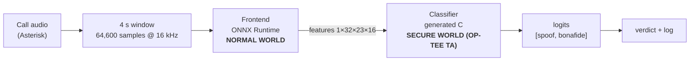

# Privacy-Preserving Edge Gateway for Real-Time Audio Deepfake Detection

**Confidential inference of an audio anti-spoofing network inside an ARM TrustZone secure world, driven by live phone calls.**

MSc in Computing, Atlantic Technological University (ATU) Galway · Waleed Asif · Supervisor: Dr. Owen Foley

Voice-cloning fraud arrives over ordinary phone calls, but detecting it normally means sending a caller's voice, and the detection model, to a host that may itself be compromised. This project runs the decision-making part of a lightweight deepfake detector (**RawTFNet-16**) inside the **secure world of an ARM TrustZone device (OP-TEE)**, so the model and its inference are isolated from the normal-world operating system. A live call through **Asterisk** is cut into 4-second windows, and each window is scored by the secure-world classifier.

This repository contains everything needed to reproduce the work, from the trained checkpoint to a verdict stream on a live call. Each stage is independently checkable, so you can stop at whichever level your hardware allows.

| | What you get | Time | Needs |
|---|---|---|---|
| **Level 1** | Score audio and regenerate the C classifier, checked against the reference logits | ~10 min | Any Linux/macOS/Windows machine with Python |
| **Level 2** | The classifier running **inside an emulated TrustZone secure world** | half a day (first build) | Ubuntu 22.04, 8 GB RAM, 60 GB disk |
| **Level 3** | Live phone call → 4-second windows → secure world → verdict stream | +1 hour | Level 2, plus a SIP softphone |

## Features

- **Confidential inference.** The decision-producing classifier of RawTFNet-16 runs inside an OP-TEE Trusted Application in the ARM TrustZone secure world, isolated from the normal-world operating system.
- **Verified deployment pipeline.** PyTorch → ONNX → standalone C → Trusted Application, with a numerical check at every stage (an independent Apache TVM cross-check, and a native x86 check of the generated C).
- **Memory-driven partitioning.** The model is split at its existing frontend/classifier seam so that it fits the roughly 16 MB secure-memory pool (the full model needs 319.5 MB).
- **Evidence of secure-world execution.** The Trusted Application logs the audio file name and the computed logits from inside the secure world.
- **Any-audio workflow.** `scripts/prepare_audio.py` resamples and normalises any WAV or FLAC file and passes it to the secure-world classifier.
- **Live-call detection.** Calls to Asterisk are cut into 4-second windows, each scored in the secure world, producing a verdict stream during the call.
- **Reproducible in three levels.** Stop at the level your hardware allows (see the table above).
- **Characterised limitation.** A controlled elimination study of why the ASVspoof-trained detector fails on real recordings (see [Results](#results)).

## Thesis and screencast

- **Thesis (PDF):** [`thesis/Masters_Thesis_Waleed_Asif.pdf`](thesis/Masters_Thesis_Waleed_Asif.pdf)
- **Screencast (under 10 minutes):** [`screencast/`](screencast/)

---

> **Honest scope.** This project was designed to run on a physical Raspberry Pi 4 edge device, which the author was unable to obtain, so there is no physical device in this work. Everything secure-world runs on the QEMU Armv8-A `virt` platform, which has the same CPU architecture and TrustZone security model but **no hardware root of trust**. That validates the software architecture and isolation, not tamper resistance. See [Limitations](#limitations).

---

## Contents

1. [Features](#features)
2. [How it works](#how-it-works)
3. [Results](#results)
4. [Repository layout](#repository-layout)
5. [Level 1: model, C code and native check](#level-1-model-c-code-and-native-check)
6. [Level 2: the secure world](#level-2-the-secure-world)
7. [Level 3: live phone calls](#level-3-live-phone-calls)
8. [Troubleshooting](#troubleshooting)
9. [Limitations](#limitations)
10. [Credits and licence](#credits-and-licence)

---

## How it works



**The model.** RawTFNet-16 takes 64,600 raw audio samples (about 4 s at 16 kHz) and returns two logits. Internally it is a *frontend* (feature extraction) followed by a *classifier*.

**The problem.** The obvious design is to run the whole model in the secure world. Compiled to dependency-free C, the full model needs about **319.5 MB** of workspace, but the secure-world memory pool is only about **16 MB**. The Trusted Application fails to load (`TEEC_OpenSession` error `0xffff000c`), and no amount of OP-TEE memory tuning fixes it.

**The fix.** The network already has a seam between its frontend and its classifier. The frontend runs in the normal world (ONNX Runtime); only the **classifier**, the part that produces the decision, is compiled to C and runs in the Trusted Application. Its input is 11,776 floats (`1×32×23×16`, 47,104 bytes), and the secure-world logits match PyTorch to six decimal places.

**The pipeline, step by step**

```
rawtfnet/ckpts/Best_RawTFNet_16.pth            trained PyTorch checkpoint
        │  rawtfnet/export_*.py
        ▼
artifacts/*.onnx                               frontend, classifier, full model
        │  scripts/clean_onnx.py   (simplify + strip BatchNorm training_mode)
        │  emx-onnx-cgen           (ONNX → one self-contained C file, weights inline)
        ▼
secure-world/trusted-app/ta/rawtfnet_model.c   classifier as plain C
        │  OP-TEE build (TA is signed and installed in the guest filesystem)
        ▼
Trusted Application  ◄── features ── client app (normal world) ◄── scripts/prepare_audio.py
```

---

## Results

| Check | Result |
|---|---|
| PyTorch vs ONNX | identical bonafide logit (−5.6216) |
| Independent cross-check (Apache TVM) | same score |
| Standalone C vs reference | identical logits `5.391142 / −5.621588` |
| Secure-world TA vs PyTorch | identical on two different clips (e.g. −4.9850 vs −4.985014) |
| Memory | full model 319.5 MB vs ~16 MB secure pool → partitioned at the frontend/classifier seam |
| Proof of in-TEE execution | the TA prints the audio filename and logits from inside the secure world |
| Real-world audio | a model trained on ASVspoof misclassifies real recordings as spoof (see below) |
| Live calls | 16 distinct 4-second windows from two live calls ran end to end, all classified spoof |

**The detector does not transfer to real speech.** The detector was evaluated on recordings of the author's own voice, a text-to-speech spoof and clips from the supervisor. Sample rate, loudness, speaker accent and background noise were eliminated one at a time as causes, leaving a genuine domain-generalisation gap between clean ASVspoof audio and real recordings. The same effect appears on live calls, where every window of genuine speech was classified as spoof. The deliverable of this project is the **confidential-inference pipeline**, which works end to end. Closing the accuracy gap (domain adaptation, fine-tuning on real speech) is future work.

Details and raw data: [`results/`](results/README.md).

---

## Repository layout

```
.
├── rawtfnet/                  RawTFNet fork + project scripts (export, test, EER)
│   └── ckpts/Best_RawTFNet_16.pth       the trained RawTFNet-16 checkpoint
├── artifacts/                 exported models: frontend / classifier / full ONNX, reference features.bin
├── scripts/                   score_audio.py, prepare_audio*.py, clean_onnx.py, tvm_verify.py, *.sh
├── secure-world/
│   ├── trusted-app/           the OP-TEE Trusted Application (ta/) and client app (host/)
│   ├── native-test/           C test harnesses for the generated model
│   ├── install_ta.sh          copy the TA into the OP-TEE tree and build
│   ├── run_qemu.sh            boot QEMU with the shared folder
│   └── optee-manifest-pinned.xml   exact OP-TEE revisions used
├── live-call/                 Asterisk config, live_detect.py (host), guest_watcher.sh (guest)
├── results/                   live-call session log and results summary
├── docs/                      progress reports, design notes, planning documents
├── requirements-quickstart.txt     minimal Python packages (Level 1)
└── requirements-pipeline.txt       exact package versions used on the VM
```

---

## Level 1: model, C code and native check

Works on any machine. No TrustZone needed.

**1. Get the code and a Python environment**

```bash
git clone https://github.com/waleed0537/masters-project.git
cd masters-project
python3 -m venv .venv && source .venv/bin/activate        # Windows: .venv\Scripts\activate
pip install -r requirements-quickstart.txt
```

**2. Check the generated C classifier against the reference** (no audio needed)

```bash
scripts/generate_ta_model.sh     # classifier ONNX → clean ONNX → C (and the TA's copy)
scripts/native_check.sh          # compile the C natively, run it on artifacts/features.bin
```

Expected:

```
logits: 5.391142 -5.621588
expected:  logits: 5.391142 -5.621588   (order: spoof, bonafide)
OK: matches the PyTorch reference
```

`artifacts/features.bin` holds the frontend features of the reference clip `LA_E_1000048.flac`. The C file is generated by `emx-onnx-cgen` with all weights inline, so it needs only a C compiler.

> `generate_ta_model.sh` rewrites `secure-world/trusted-app/ta/rawtfnet_model.c`. The version committed here is the one used to produce the secure-world results; regenerating gives the same code apart from two comment lines in the file header. Use `git checkout` to restore it if you want the committed version back.

**3. Score real audio** (optional, needs an audio file)

```bash
python scripts/score_audio.py path/to/clip.flac
```

```
clip.flac    spoof logit=+5.39…    bonafide logit=-5.62…    SPOOF (fake)
```

Evaluation clips come from **ASVspoof 2021 LA eval** ([Zenodo 4837263](https://zenodo.org/records/4837263), CC BY 4.0). The archive is large and you only need a few clips. `LA_E_1000048.flac` should reproduce the reference logits above (to about four decimals; small differences can come from the audio-loading library version). Any WAV or FLAC works: audio is resampled to 16 kHz and peak-normalised (use `--no-normalize` to skip that; ASVspoof files are already peak-normalised).

**4. (Optional) Re-export the models from the checkpoint.** Needs PyTorch (`pip install -r rawtfnet/requirements.txt`, or use `rawtfnet/environment.yml`):

```bash
scripts/export_all.sh /path/to/LA_E_1000048.flac
```

This exports the frontend, classifier and full model into `artifacts/` and rewrites `features.bin`. To retrain from scratch or evaluate on ASVspoof, see [`rawtfnet/README.md`](rawtfnet/README.md).

**5. (Optional) Independent cross-check with Apache TVM**

```bash
pip install -r requirements-pipeline.txt        # exact VM environment, includes apache-tvm
python scripts/tvm_verify.py artifacts/rawtfnet.onnx /path/to/LA_E_1000048.flac
```

---

## Level 2: the secure world

Everything here runs on **Ubuntu 22.04 LTS** (the author used a VirtualBox VM with a **bridged** network adapter, 4+ cores, 8+ GB RAM and ~60 GB of disk). Do not use Git Bash/MINGW, WSL1 or Cygwin: the OP-TEE build system is Linux-only.

### 2.1 Install build dependencies

```bash
sudo apt update && sudo apt install -y android-tools-adb android-tools-fastboot \
  autoconf automake bc bison build-essential ccache cscope curl device-tree-compiler \
  expect flex ftp-upload gdisk libattr1-dev libcap-dev libcap-ng-dev libfdt-dev \
  libftdi-dev libglib2.0-dev libhidapi-dev libncurses5-dev libpixman-1-dev \
  libslirp-dev libssl-dev libtool make mtools netcat ninja-build \
  python3-cryptography python3-pip python3-pyelftools python3-serial \
  python3-venv rsync unzip uuid-dev xdg-user-dirs xterm xz-utils zlib1g-dev git \
  libgnutls28-dev cmake libprotobuf-dev protobuf-compiler ffmpeg libsndfile1

mkdir -p ~/bin
curl https://storage.googleapis.com/git-repo-downloads/repo > ~/bin/repo
chmod a+x ~/bin/repo
echo 'export PATH=~/bin:$PATH' >> ~/.bashrc && export PATH=~/bin:$PATH
git config --global user.name "Your Name"
git config --global user.email "you@example.com"
```

### 2.2 Build OP-TEE for QEMU (first build: 1–3+ hours)

```bash
mkdir -p ~/optee && cd ~/optee
repo init -u https://github.com/OP-TEE/manifest.git -m qemu_v8.xml
repo sync -j4
cd build
make toolchains -j2
make -j$(nproc)
```

**To reproduce the exact revisions used here**, use the pinned manifest instead of the default branch:

```bash
cd ~/optee
repo init -u https://github.com/OP-TEE/manifest.git -m qemu_v8.xml
cp <this-repo>/secure-world/optee-manifest-pinned.xml .repo/manifests/pinned.xml
repo init -m pinned.xml
repo sync -j4
```

Use `qemu_v8.xml` (Armv8-A), not the default 32-bit manifest. `make` on its own is correct for QEMU; there is no flashing step.

### 2.3 Boot it and run the test suite

```bash
cd ~/optee/build && make run
```

Two terminal windows open (Normal World and Secure World). At the `(qemu)` prompt type `c` and press Enter. Log in to the Normal World as `root` (no password), then:

```bash
xtest                       # OP-TEE test suite; expect 0 failures
optee_example_hello_world   # proves the build, signing and TA/CA handshake all work
```

Do not skip `hello_world`: it separates toolchain problems from problems with this project's code.

### 2.4 Install the Trusted Application

On the Ubuntu host, with **no Python virtualenv active**:

```bash
deactivate 2>/dev/null || true      # TA signing needs the system Python's `cryptography` module
secure-world/install_ta.sh          # copies secure-world/trusted-app → ~/optee/optee_examples/rawtfnet and runs make
```

This rebuilds the root filesystem with `optee_example_rawtfnet` (the client app) and the signed TA (UUID `ba70f032-7f54-4882-8002-1d7c133d81c9`). No OP-TEE core build flags are needed. The TA's memory limits (`TA_DATA_SIZE` 4 MB, `TA_STACK_SIZE` 256 KB) are set in `ta/user_ta_header_defines.h`.

### 2.5 Run the classifier in the secure world

Shut QEMU down first if it is running (`poweroff` in the Normal World), then:

```bash
mkdir -p ~/qemu_share
cp artifacts/features.bin ~/qemu_share/current.bin       # reference features
echo "reference" > ~/qemu_share/current_label.txt
secure-world/run_qemu.sh                                  # boots QEMU with the folder shared over 9p
```

At `(qemu)` type `c`. Log in as `root`, mount the shared folder and run the client app:

```bash
mkdir -p /mnt/host && mount -t 9p -o trans=virtio host /mnt/host
optee_example_rawtfnet
```

Expected, in the **Normal World** window:

```
================================================
 Audio file being checked: reference
================================================
Sending to secure world (TrustZone)...
------------------------------------------------
 RESULT for reference
 Spoof logit:    5.391142
 Bonafide logit: -5.621588
 Verdict: SPOOF (fake)
------------------------------------------------
```

and in the **Secure World** window, printed from inside the TA (this is the evidence that the computation ran in the secure world, tied to that specific input):

```
=== SECURE WORLD: processing audio file: reference ===
=== SECURE WORLD: reference -> logits=[5391, -5621] (x1000) ===
```

### 2.6 Run any audio file through it

On the Ubuntu host (the model environment from Level 1; QEMU can stay running, since the folder is shared live):

```bash
python scripts/prepare_audio.py /path/to/any_audio.wav     # frontend → ~/qemu_share/current.bin + label
```

Then in the QEMU Normal World: `optee_example_rawtfnet`. The secure-world logits should match `python scripts/score_audio.py` on the same file.

`scripts/prepare_audio_denoise.py` is the denoising variant used in the out-of-distribution elimination study.

---

## Level 3: live phone calls

A softphone calls Asterisk on the VM. Asterisk records the caller's audio to a growing file, a host script cuts the latest 4 seconds every 4 seconds, and a watcher loop inside QEMU runs the secure-world classifier on each window.

```
Softphone (Windows) ──SIP──▶ Asterisk (Ubuntu VM) ──▶ /tmp/live.wav16 (grows during the call)
                                                          │
                       live-call/live_detect.py: latest 64,600 samples → frontend → ~/qemu_share
                                                          │  (current.bin, label, "go")
              QEMU guest: guest_watcher.sh sees "go" → optee_example_rawtfnet (SECURE WORLD)
                                                          │
                                       verdict printed in the guest + appended to results.log
```

### 3.1 Install and configure Asterisk (Ubuntu VM)

```bash
SIP_PASSWORD='choose-a-password' live-call/setup_asterisk.sh
```

This installs Asterisk, adds one softphone extension (`100`) and one detection line (`600`: answer, record the caller to `/tmp/live.wav16`, stay silent), restarts Asterisk and prints the VM's IP addresses. The configs are in [`live-call/`](live-call/); `G.722` is listed first so a capable softphone carries true 16 kHz audio.

### 3.2 Softphone (Windows)

Install a SIP softphone such as [MicroSIP](https://www.microsip.org/) (free; supports G.722), then add an account:

| Field | Value |
|---|---|
| SIP server / Domain | the VM's IP (`ip -br a`) |
| Username / Login | `100` |
| Password | the `SIP_PASSWORD` you chose |

The status should turn green. Confirm on the VM: `sudo asterisk -rx "pjsip show endpoints"` shows endpoint 100 as available. With bridged networking the VM's IP can change after a reboot, so re-check it if registration fails.

### 3.3 Start everything, in this order

| # | Where | Do |
|---|---|---|
| 1 | Ubuntu terminal A | `secure-world/run_qemu.sh`, then `c` at the `(qemu)` prompt |
| 2 | Copy the watcher | `cp live-call/guest_watcher.sh ~/qemu_share/` |
| 3 | QEMU Normal World | log in as `root`, then `mkdir -p /mnt/host && mount -t 9p -o trans=virtio host /mnt/host && sh /mnt/host/guest_watcher.sh` |
| 4 | Ubuntu terminal B | `sudo rm -f /tmp/live.wav16`, then `source .venv/bin/activate && python live-call/live_detect.py` |
| 5 | Softphone | dial **600** and speak (the call answers to silence; that is correct) |
| 6 | Watch | a labelled verdict every ~4 s in the guest (`LIVE_win3_8s-12s` = window 3, seconds 8–12), the matching proof lines in the Secure World window |
| 7 | After hang-up | `Ctrl+C` the detector; the session log is `~/qemu_share/results.log` |

`live_detect.py` reads the recording as raw 16 kHz mono PCM. For overlapping windows (a verdict every 2 s) run `STRIDE=2.0 python live-call/live_detect.py`. Start each demo with `sudo rm -f /tmp/live.wav16`.

**What to expect.** Live human speech is out of domain for this detector, so verdicts will lean **SPOOF**. That is the documented domain-generalisation limitation, not a pipeline fault. To see in-domain behaviour, play an ASVspoof evaluation clip into the call (a virtual audio cable such as VB-CABLE as the softphone microphone is the cleanest way) and compare a bonafide clip with a spoof clip. A real recorded session is in [`results/`](results/README.md).

---

## Troubleshooting

| Symptom | Cause and fix |
|---|---|
| `TEEC_OpenSession failed 0xffff000c origin 0x3` | The TA is too large to load. This is the memory failure the project documents: the whole model does not fit the secure pool. Only the classifier (this repo's design) fits. |
| TA build fails at signing, `cryptography` import error | A Python virtualenv is active. Run `deactivate` and rebuild; signing needs the system Python. |
| `/mnt/host` is empty | The folder must be mounted in every boot (`mount -t 9p -o trans=virtio host /mnt/host`), and QEMU must be started with `QEMU_VIRTFS_ENABLE=y` (`secure-world/run_qemu.sh` does this). |
| Guest loop never fires | Shared folder not mounted in this boot, or `live_detect.py` is not running. |
| Softphone will not register | VM IP changed (`ip -br a`), or a firewall is blocking SIP/RTP: `sudo ufw allow 5060/udp && sudo ufw allow 10000:20000/udp`. |
| `live_detect.py` cannot read `/tmp/live.wav16` | `sudo usermod -aG asterisk $USER`, then log out and in, or `sudo chmod 644 /tmp/live.wav16`. |
| Verdicts repeat identically | The recording stopped growing (call ended or detector stopped). The loop does not detect end-of-call. |
| Odd scores on ulaw/alaw calls | 8 kHz telephone audio is being resampled to 16 kHz. Enable G.722 in the softphone for true wideband. |
| First OP-TEE build fails | Almost always a missing apt package; re-run with `make 2>&1 \| tee build.log` and check the log. |

---

## Limitations

- **No physical device and no hardware root of trust.** The intended Raspberry Pi 4 edge device was not available. All results are from the QEMU Armv8-A `virt` platform. This validates the software architecture and isolation model, not device-specific behaviour or hardware-backed attestation.
- **Only the classifier is confidential.** The frontend runs in the normal world, so an attacker with normal-world root could supply manipulated features. The model weights and the decision computation are what the secure world protects.
- **Weights are compiled into the TA.** A production system would load them from secure storage so the TA does not need re-signing on each retrain.
- **The detector does not generalise to real speech** (see [Results](#results)).
- **Live capture polls a growing file** rather than streaming from Asterisk, windows are non-overlapping by default, end-of-call is not detected, and the running decision rule and dashboard of the target design are not implemented. The live results come from two calls placed by the author.
- **No side-channel hardening.**

---

## Credits and licence

- **RawTFNet** by Austin Xiao et al.: *RawTFNet: A Lightweight CNN Architecture for Speech Anti-spoofing*, [arXiv:2507.08227](https://arxiv.org/abs/2507.08227). The code in [`rawtfnet/`](rawtfnet/) is a fork of the authors' implementation and is released under its original MIT licence ([`rawtfnet/LICENSE`](rawtfnet/LICENSE)).
- **OP-TEE** ([optee.readthedocs.io](https://optee.readthedocs.io)) and the `optee_examples` skeleton the Trusted Application is built from.
- **emx-onnx-cgen** (emmtrix) for ONNX → C generation; **Apache TVM** for the independent cross-check; **ONNX Runtime** for the normal-world frontend.
- **ASVspoof 2019/2021** datasets for training and evaluation.
- **Asterisk** for the telephony side.

Project work by Waleed Asif, supervised by Dr. Owen Foley, ATU Galway.
